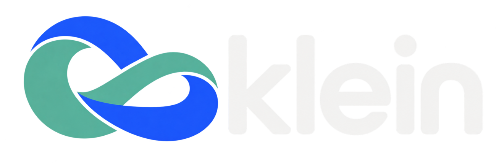
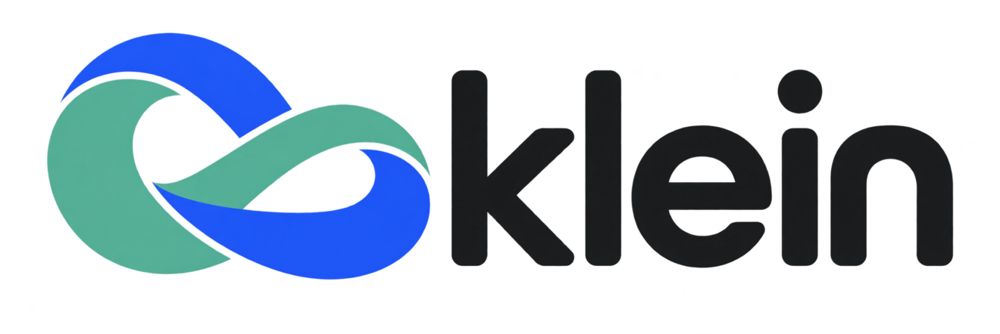
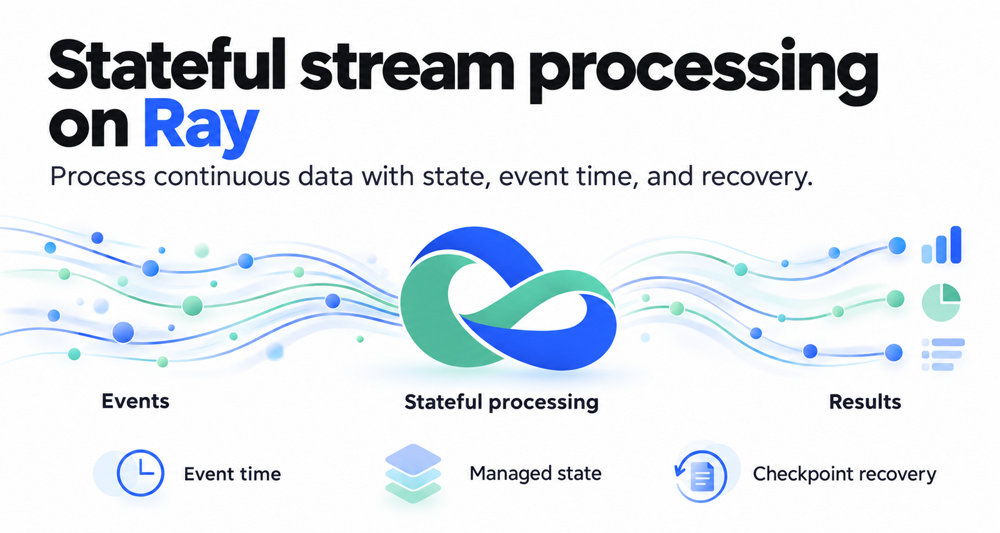

<!-- SPDX-License-Identifier: Apache-2.0 -->

<p align="center">
  <a href="https://github.com/yuchen-ecnu/klein#gh-dark-mode-only">
    
  </a>
  <a href="https://github.com/yuchen-ecnu/klein#gh-light-mode-only">
    
  </a>
</p>

<p align="center"><strong>Stateful stream processing on Ray.</strong></p>

<p align="center">
  <a href="https://github.com/yuchen-ecnu/klein/actions/workflows/ci.yml"></a>
  
  
  
  <a href="LICENSE"></a>
</p>

<p align="center">
  <a href="#quick-start">Quick start</a> ·
  <a href="https://yuchen-ecnu.github.io/klein/latest/">Documentation</a> ·
  <a href="https://yuchen-ecnu.github.io/klein/latest/zh_CN/">中文文档</a> ·
  <a href="docs/examples.md">Examples</a>
</p>

Klein is a Python library for stateful stream processing on Ray. Build
continuous applications with keyed state, event-time windows, and checkpoint
recovery. The `DataStream` and SQL APIs also support bounded data pipelines.



## Why Klein?

- **Process events with state.** Build keyed aggregations, event-time windows,
  and stateful transformations with managed state, timers, and watermarks.
- **Recover a running pipeline.** Coordinate source positions and managed
  state through durable checkpoints, then restore supported jobs after failure.
- **Stay in your Ray environment.** Use Ray Data readers for bounded inputs,
  Python or SQL for transformations, and the Dashboard and CLI to operate jobs.

Klein fits applications that need continuous processing, event-time progress,
or recoverable state on Ray. For bounded data preparation or training ingest
without those requirements, [Ray Data](https://docs.ray.io/en/latest/data/data.html)
may already cover your needs.

> [!NOTE]
> Klein is an independent **alpha** project, not affiliated with, endorsed by,
> or maintained by Ray. Public APIs and checkpoint formats may change before 1.0.

## Quick start

Use Python **3.10–3.12** on Linux or macOS. Installation from source includes
the supported Ray dependency (`ray[data]>=2.56.1,<2.57`).

```bash
git clone https://github.com/yuchen-ecnu/klein.git
cd klein
python -m venv .venv
source .venv/bin/activate
python -m pip install --upgrade pip
python -m pip install .
```

Run a small bounded pipeline:

```python
import ray.klein as klein

pipeline = klein.pipeline(name="quick-start")
rows = (
    pipeline.from_items(
        [
            {"name": "Ada", "amount": 4},
            {"name": "Grace", "amount": 7},
        ]
    )
    .map(lambda row: {**row, "amount": row["amount"] * 2})
    .collect()
    .result()
)

print(rows)
# [{'name': 'Ada', 'amount': 8}, {'name': 'Grace', 'amount': 14}]
```

Transformations build a lazy graph. `collect()` submits the explicit pipeline;
`result()` waits for its rows. No broker or external data source is needed for
this example.

**Next, connect real data:** follow the
[Kafka streaming walkthrough](docs/getting-started.md#submit-a-dataflow),
[SQL quick start](docs/sql/getting-started.md), or
[checkpointed streaming example](docs/production-streaming.md).

Install only the extras you need, such as `python -m pip install ".[kafka]"`.
The [installation guide](docs/installation.md) covers all extras, cluster setup,
and checks for vendor Ray builds that already provide `ray.klein`.

## What you can build with

| Capability | What it provides | Guide |
| --- | --- | --- |
| State and event time | Keyed value, list, and map state; TTL; timers; watermarks; windows. | [Managed state](docs/ray-native-state.md) · [Event time](docs/event-time.md) |
| Recovery | Durable checkpoints, source-position restore, and replay-aware sinks. | [Checkpoint recovery](docs/checkpoint-recovery.md) |
| SQL and tables | Bounded queries and continuous queries with explicit changelog rows. | [SQL and Table APIs](docs/sql.md) |
| Inputs and outputs | Ray Data, Kafka, RocketMQ, filesystems, Iceberg, Redis, and custom connectors. | [Connector catalog](docs/connectors/index.md) |
| Ray integration | Ray Data readers and Dataset adapters; eligible transform chains behind Ray Serve. | [Ray Data](docs/ray-data-interop.md) · [Ray Serve](docs/connectors/ray-serve.md) |
| Operations | Dashboard, metrics, CLI inspection, detached jobs, and supported live operator rescaling. | [Observability](docs/observability.md) · [Rescaling](docs/operator-rescaling.md) |

Runtime selection happens per job: compatible bounded graphs lower to
Ray Data; streaming graphs run as long-lived Ray actors. See
[how runtime selection works](docs/ray-data-interop.md).

Delivery guarantees depend on the source and sink. General delivery is
at least once; checkpoint-aware filesystem and Iceberg outputs have their own
publication contracts. Review [delivery semantics](docs/delivery-semantics.md)
and [operator compatibility](docs/operator-compatibility.md) for your graph.

### Inspect jobs in the Dashboard

The Dashboard ships with Klein and runs on port **8266**. It provides job
status, operator graphs, checkpoint inspection, and configuration. Links to
Ray-owned views open the native Ray Dashboard on port **8265**.

```bash
ray-klein dashboard --open \
  --ray-dashboard-url http://127.0.0.1:8265
```

See the [operations guide](docs/observability.md) for connecting to a cluster,
metrics, and CLI access.

## Go further

| Your next step | Start here |
| --- | --- |
| Learn the programming model | [Key concepts](docs/key-concepts.md) · [DataStream guide](docs/datastream-programming-guide.md) · [Examples](docs/examples.md) |
| Understand the implementation | [Architecture](docs/architecture.md) · [Feature guides](docs/features.md) |
| Run a continuous job | [Production walkthrough](docs/production-streaming.md) · [Deployment](docs/deployment.md) |
| Evaluate a deployment | [Known limitations](docs/limitations.md) · [Production readiness](docs/production-readiness.md) · [Security](docs/security.md) |
| Look up an API or solve a problem | [API reference](docs/api/api.rst) · [Configuration](docs/configuration-reference.md) · [Troubleshooting](docs/troubleshooting.md) |

Browse the full documentation in
[English](https://yuchen-ecnu.github.io/klein/latest/) or
[中文](https://yuchen-ecnu.github.io/klein/latest/zh_CN/).
Klein targets one tested Ray minor release; read the
[compatibility policy](docs/compatibility.md) before changing dependencies and
[upgrade guidance](docs/upgrading.md) before restoring existing checkpoints.

## Contributing and support

Start with [CONTRIBUTING.md](CONTRIBUTING.md) for development setup, tests,
and pull requests. See [SUPPORT.md](SUPPORT.md) for questions and bug reports,
and [SECURITY.md](SECURITY.md) for private vulnerability reporting.

[Governance](GOVERNANCE.md) · [Changelog](CHANGELOG.md) · [Citation](CITATION.cff)

<details>
<summary>Why “Klein”?</summary>

The name comes from the Klein bottle and the idea of taking a Möbius loop one
dimension further. The blue and mint ribbons suggest continuous dataflow and
the connection between bounded datasets and unbounded streams. The mark is
inspired by topology, rather than a literal projection of a Klein bottle.
[Brand assets and artwork sources](docs/brand/README.txt) are kept in the repository.

</details>

## License

[Apache License 2.0](LICENSE). See [NOTICE](NOTICE),
[PROVENANCE.md](PROVENANCE.md), and [TRADEMARKS.md](TRADEMARKS.md) for attribution
and project identity.
